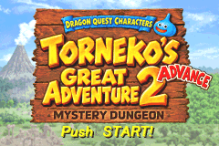
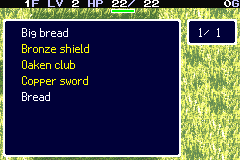
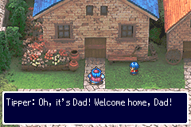
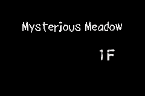

# Torneko 2 Advance — English translation

**Made with AI assistance.** An unofficial English localization of
*Dragon Quest Characters: Torneko no Daibouken 2 Advance — Fushigi no Dungeon*
for Game Boy Advance.

## Screenshots

| English title | Inventory |
|---|---|
|  |  |
| **Dialogue** | **Dungeon arrival** |
|  |  |

Actual mGBA screenshots from the English build, captured through ordinary play
from a fresh save. [Capture details and reproduction](docs/SCREENSHOTS.md).

## Project status

**Ready for release-candidate testing.** There is no confirmed outstanding
localization defect in the investigated paths. Whole-game scene/state coverage
and broader independent playtesting remain incomplete, so a stable 1.0 sign-off
is not yet supported. The recommended release label is **1.0-rc1**; this assessment
does not rename the existing checkpoint or change the build manifest's
`development` status.

The build contains **3,814 inserted text resources and 20 English graphics**,
including the title, five floating corner logos, 13 dungeon arrival names and
Level. It uses the Torneko 2 compact English font, supports seven-character
player names and English Blank-scroll inputs, and preserves the original English
GBA credits. [Blank-scroll instructions and accepted inputs](docs/BLANK_SCROLLS.md).

The latest local checkpoint is the
[October 7 text-audit release](build/releases/2026-10-07-text-audit.zip).
The root `build/torneko-2-english.gba` and `.bps` were freshly compiled and verified
by independent patch application. They match the accepted October 4 ROM/BPS;
the subsequent audits added evidence without changing game bytes. The manifest
beside them records the exact hashes.

Recent work repairs the separate dungeon banner and Floor/empty-Items readers,
status-expiry messages, missed item/service/combat callers, pot and Mimic tutorial
selectors, and two shopkeeper conversation selectors. English custom item names
and their price layouts are also verified. The
[caller history](docs/CALLER_FOLLOWUP.md) and
[coverage matrix](docs/COVERAGE_AUDIT.md) identify each repair and its validation.

All **96 retained untranslated catalog sources** now have
[individual investigation dispositions](docs/TEXT_SOURCE_DISPOSITIONS.md).
The recovered caller/script graphs do not select them under the documented
bounds. Their original bytes remain preserved; they are not an outstanding
translation queue or proof of complete game coverage.

The latest research suite passes **191 unit tests**. The link-error audit checks
all five English errors through their callers in **15 scenarios / 24 peer routes
and cold loads**. Earlier full cumulative and font checks retain their own ROM
identities; they are not presented as fresh runs of this checkpoint.

**Original gameplay behavior, including original bugs, is preserved.** The
[link audit](docs/LINK_ERROR_AUDIT.md) reproduces an original item-loss bug in two
post-save fault branches; that finding is documented and closed without a
behavior change. Further graphics auditing is stopped.

The next release-confidence step is broader independent playtesting, with
reproducible text reports investigated through code and targeted native probes.
Completed investigations stay closed unless new evidence contradicts them.

[Current coverage and evidence](docs/COVERAGE_AUDIT.md) ·
[Research history](docs/TEXT_PROGRESS.md) ·
[Text decisions and remaining limits](docs/TEXT_OPEN_QUESTIONS.md)

## Setup

Use the project's Python 3.11 environment, native mGBA bindings and local tools.
You need your own matching Japanese ROM, identified in [config/rom.json](config/rom.json).
Torneko 3 supplies the tooling reference; this translation uses Torneko 2's
Japanese text and verified resource layouts.

[Installation and tool choices](docs/TOOLING.md)

## Build and play

From the project root:

```sh
./build.sh
```

| Output | Use |
|---|---|
| `build/torneko-2-english.gba` | Open a playtest copy in your GBA emulator |
| `build/torneko-2-english.bps` | Apply to the clean Japanese ROM |
| `build/torneko-2-english.release.json` | Source, ROM and patch hashes; build status |

The build compiles the translation, verifies that the BPS reproduces the ROM,
and runs native emulator checks. Compilation uses retained source assets;
the complete validation workflow also uses the documented research fixtures.
These latest-build files remain development outputs while localization and
playtesting are in progress.

[Build requirements, patching and checks](docs/BUILD.md)

[Blank scrolls and all accepted English writing inputs](docs/BLANK_SCROLLS.md)

## Translate and revise

Translate from the Japanese, follow the glossary and agreed Dragon Quest
terminology, and preserve controls and substitutions. Check the actual font
and window budgets, including the widest supported names and numbers. Item
names must stay on one line; combat messages should use one line when their
complete meaning safely fits. Revisions need checked insertion ownership and
fresh native validation before they reach the ROM.

[Translation and prose rules](docs/LOCALIZATION_PLAN.md) ·
[Glossary](translations/glossary.json) · [Menu budgets](docs/MENU_LAYOUTS.md)

## Test and report bugs

Play a separate copy of the latest English ROM and keep its battery save beside
it. Preserve the original Japanese ROM and supplied save. When reporting a
problem, include a screenshot, reproduction steps, the matching save/state,
emulator version and ROM hash from the release manifest. A save immediately
before the problem is especially useful for checking a fix.

[Current validation scope](docs/TEXT_PROGRESS.md) ·
[Emulator and capture workflow](docs/EXPLORATION.md)

## Graphics and research

[Title and background logos](docs/TITLE_INSERTION.md) ·
[Arrival cards](docs/ARRIVAL_INSERTION.md) ·
[Credits and graphics auditions](docs/GRAPHICS_AUDITION.md)

Record discoveries in the [memory map](docs/MEMORY_MAP.md) before insertion;
use the shared allocator and checked patch ownership to prevent collisions.

[Documentation index](docs/README.md) · [Preserved graphics audit](docs/GRAPHICS_INVENTORY.md)
